# Sai Tarrun Pitta

**Software Engineer — distributed systems, cloud native platforms, and applied GenAI**

---

### About me

- 🔭 3+ years building production Java, Python, and Go microservices — previously at Cognizant, Accenture, and Pacific Life
- 🎓 MS in Computer Science, Cal State Fullerton
- 🧠 Deep in LLM serving and RAG pipelines — I contribute to open source ([sgl-project/sglang#43628](https://github.com/sgl-project/sglang/pull/43628))
- 💼 Open to Software Engineer roles — distributed systems, backend, AI infrastructure

### Stack

### Stats

### Featured work

| Project | What it is |
|---|---|
| [LeetMap-Pro](https://github.com/saitarrun/LeetMap-Pro) | Free, open source, company wise LeetCode + SQL interview platform across 680+ companies — [live](https://www.leetmap-pro.com) |
| [Devforge-ai](https://github.com/saitarrun/Devforge-ai) | Agent driven SDLC workflow — plan, build, verify, ship, maintain — [on npm](https://www.npmjs.com/package/@saitarrunpitta/devforge-ai) |
| [Semantic-code-intelligence](https://github.com/saitarrun/Semantic-code-intelligence) | Local first semantic code search — FAISS, BM25, cross encoder reranking |
| [Trojan-Detection-in-Deep-Neural-Networks](https://github.com/saitarrun/Trojan-Detection-in-Deep-Neural-Networks) | Distributed MLOps platform for detecting neural backdoors in deep learning models |

### Open source

- [sgl-project/sglang#43628](https://github.com/sgl-project/sglang/pull/43628) — fail fast when `dtype=float32` is used with the FlashInfer attention backend (fixes a mid startup engine crash with an actionable config error)

---

*Building systems by day — breaking them by night.*

